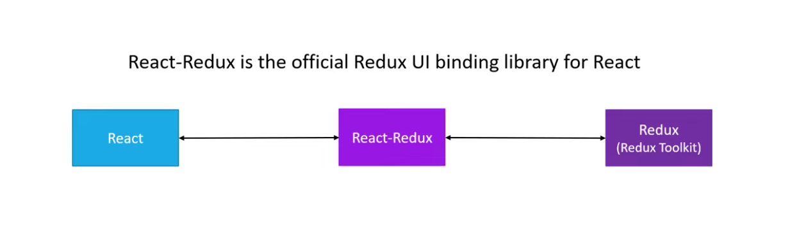
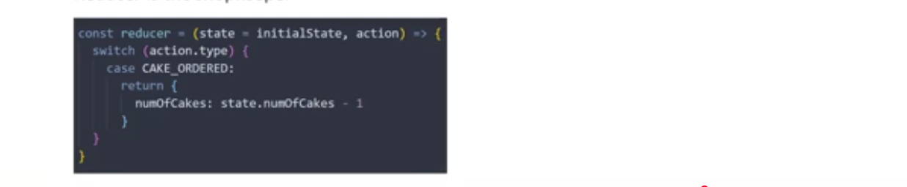
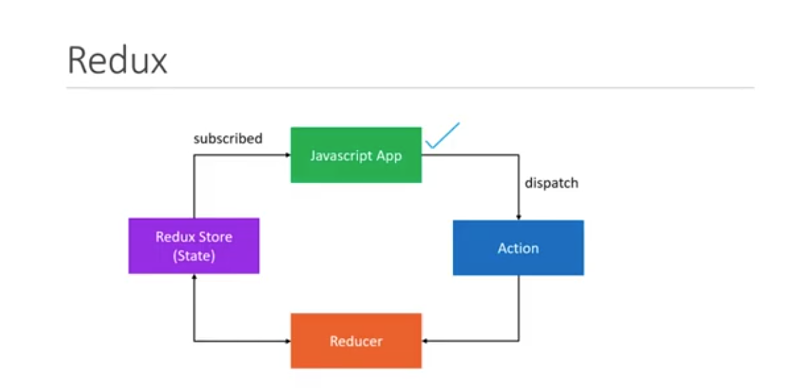
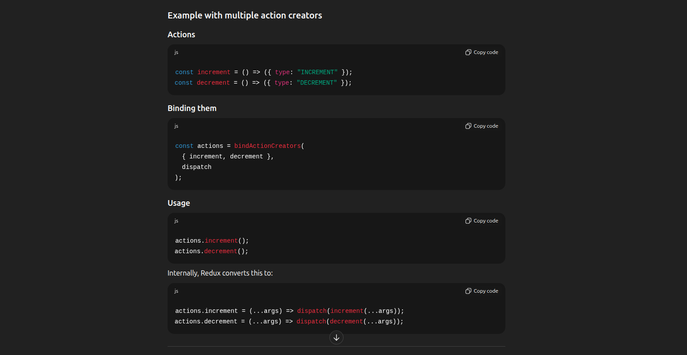

# Why Redux Toolkit?
Redux is great,but it does have a few shortcomings.
- Configuring redux in an apps seems complicated
- In addition to redux, a lot of other packages have to be installed to get redux to do something useful.
- Redux requries too much boilerplate code.

Redux toolkit serves as an abstraction over redux. It hides the difficult parts ensuring you have a good developer experience.

# React-Redux


# Summary

- React is a library used to build user interfaces
- Redux is a library for managing state in predictable way in Javascript applications.
- Redux toolkit is a library for efficient redux development.
- React-redux is a library that provides bindings to use React and Redux (Toolkit) together in an application.


# Three core concept of redux
- A ***store*** that holds the state of your application.
- An ***action*** that describes what happended in the application.
- A ***reducer*** which handles the action and decides how to update the state.

# Three Principles

# First Principle
- The ***global*** state of your application is stored as an object inside a single store.
- Maintain our application state in a single object which would be managed by the Redux store.

# Cake Shop
Let's assume we are tracking the number of cakes on the shelf

`
{
    numberOfCakes:10
}
`

# Second Principle
- The only way to change the state is to dispatch an action, an object that describes what happend.

To Update the state of your app, you need to let Redux know about that with an action not allowed to directly update the state object.

# Cake Shop
Scan the QR and place an order - CAKE_ORDER
`
{
    type:'CAKE_ORDERED'
}
`

# Third Principle
- To specify how the state tree is updated based on actions, you write pure reducers.

Reducer - (previousState,action)=>newState

# Cake Shop
Reducer is the shopkeeper



# Action
- The only way your application can interact with the store
- Carry some information from your app to the redux store
- Plain Javascript objects.
- Have a 'type' property that describes something that happened in the application.
- The 'type' property is typically defined as string constants.


# Reducers
- Specify how the app's state changes in response to actions sent to the store.
- Function that accepts state and action as arguments, and returns the next state of the application.
- (previousState,action)=>newState

# Redux Store
one store for the entire application

Responsibilites
- Holds application state
- Allows access to state via ***getState()***
- Allows state to be updated via ***dispatch(action)***
- Registers listeners via ***subscribe(listener)***
- Handles unregistering of listeners via the function returned by ***subscribe(listener)***


# bindActionCreators
`bindActionCreators` is a Redux utility function that helps you `bind` `action` `creators` to the dispatch function, so you can call them directly without manually calling dispatch every time.

# The problem bindActionCreators solves
Normally in Redux, you do this:
```
dispatch(addTodo("Learn Redux"));
```
But sometimes you want to just do:

```
addTodo("Learn Redux");
```
👉 bindActionCreators makes this possible.

# What it is
`bindActionCreators(actionCreators, dispatch)`

It takes:
1. actionCreators – a function or an object of action creator functions
2. dispatch – the Redux store’s dispatch function

And returns:
- the same action creators, but already wrapped with dispatch.



# combineReducers

combineReducers is a Redux utility function used to split a large reducer into multiple smaller reducers, where each reducer manages its own slice of the state.

# What combineReducers does

```
combineReducers({
  sliceName: sliceReducer,
  anotherSlice: anotherReducer
})

```
- Takes an object of reducers
- Returns one root reducer
- Each reducer manages its own key in the state object


# configureStore
configureStore is a Redux Toolkit (RTK) API that replaces the old createStore.
It is now the official and recommended way to create a Redux store.


# What is configureStore?
`configureStore` is a helper function that:
- Creates the Redux store
- Combines reducers
- Adds middleware (Thunk included by default)
- Enables Redux DevTools
- Adds safety checks (immutability & serializability)


# Redux Toolkit – Simple Notes (Beginner Friendly)

These notes are written so that **even a beginner** can understand Redux Toolkit store and middleware. You can use this as **future reference notes**.

---

## 1. What is Redux Toolkit (RTK)?

Redux Toolkit is the **official and recommended way** to use Redux.

It helps you:

* Write less code
* Avoid common Redux mistakes
* Handle async logic easily

📌 **Rule**: Always prefer Redux Toolkit over old Redux.

---

## 2. What is `configureStore`?

`configureStore` is a function that **creates the Redux store**.

It automatically:

* Combines reducers
* Adds thunk middleware
* Enables Redux DevTools
* Adds safety checks

### Basic example

```js
import { configureStore } from "@reduxjs/toolkit";
import userReducer from "./userSlice";

export const store = configureStore({
  reducer: {
    user: userReducer,
  },
});
```

📌 You do NOT need `createStore`, `applyMiddleware`, or `redux-thunk` separately.

---

## 3. What is Middleware? (Very Important)

Middleware is code that runs **between dispatch and reducer**.

```
dispatch(action)
   ↓
middleware
   ↓
reducer
```

Middleware is used for:

* Async code (API calls)
* Logging actions
* Error handling
* Analytics

📌 Reducers must stay **pure** (no async, no side effects).

---

## 4. Default Middleware in Redux Toolkit

Redux Toolkit adds these **automatically**:

1. **Thunk middleware** → allows async actions
2. **Immutability check** → prevents direct state mutation
3. **Serializable check** → ensures state/actions are serializable

That’s why this works without setup:

```js
dispatch(fetchUser());
```

---

## 5. What is `getDefaultMiddleware`?

`getDefaultMiddleware` gives you all RTK default middleware.

You use it when:

* You want to **add** your own middleware
* You want to **modify** default behavior

📌 Always keep defaults unless you know what you’re doing.

---

## 6. Adding Custom Middleware

### Example: Logger middleware

```js
const loggerMiddleware = (store) => (next) => (action) => {
  console.log("Action:", action);
  return next(action);
};
```

### Add it to store

```js
configureStore({
  reducer,
  middleware: (getDefaultMiddleware) =>
    getDefaultMiddleware().concat(loggerMiddleware),
});
```

📌 `concat` means: keep defaults + add new middleware.

---

## 7. Common Mistake ❌ (Very Important)

❌ Wrong way:

```js
middleware: [loggerMiddleware]
```

Why wrong?

* Removes thunk
* Removes safety checks

✅ Correct way:

```js
middleware: (getDefaultMiddleware) =>
  getDefaultMiddleware().concat(loggerMiddleware)
```

---

## 8. Serializable Check (Simple Explanation)

Redux state should contain **plain data**:

* string
* number
* boolean
* array
* object

❌ Not allowed by default:

* Date
* Map / Set
* Functions

### Disable serializable check (if needed)

```js
configureStore({
  reducer,
  middleware: (getDefaultMiddleware) =>
    getDefaultMiddleware({
      serializableCheck: false,
    }),
});
```

⚠️ Disable only when necessary.

---

## 9. Ignoring Specific Paths (Better than disabling)

```js
getDefaultMiddleware({
  serializableCheck: {
    ignoredPaths: ["user.token"],
    ignoredActions: ["user/loginSuccess"],
  },
});
```

📌 Best practice for real apps.

---

## 10. Thunk vs Middleware (Easy Difference)

| Thunk               | Middleware             |
| ------------------- | ---------------------- |
| For async API calls | For global logic       |
| Feature specific    | App wide               |
| Uses dispatch       | Intercepts all actions |

📌 Most API logic should be in **thunks**, not middleware.

---

## 11. Middleware Order

Middleware runs in the order you add it:

```js
getDefaultMiddleware().concat(logger, analytics)
```

Execution order:

```
Thunk → checks → logger → analytics → reducer
```

---

## 12. Full Simple Store Example

```js
import { configureStore } from "@reduxjs/toolkit";
import userReducer from "./userSlice";

export const store = configureStore({
  reducer: {
    user: userReducer,
  },
});
```

That’s enough for **90% of applications**.

---

## 13. Golden Rules (Remember This)

✅ Always use `configureStore`
✅ Keep reducers pure
✅ Use thunks for async logic
✅ Use middleware for global side effects
❌ Don’t overwrite default middleware

---

## 14. One-Line Summary

> Redux Toolkit gives you **safe defaults**, middleware lets you **extend behavior**, and `configureStore` ties everything together.

---

📘 You can bookmark or copy these notes for future revision.


# Redux Toolkit (RTK) – **extraReducers** Complete Notes 🧠

---

## 1️⃣ What is `extraReducers`?

**Simple definition:**

> `extraReducers` allows a slice to handle **actions that were NOT created inside that slice**.

That’s the **core idea**. Everything else builds on this.

---

## 2️⃣ Why does `extraReducers` exist?

Normally, a Redux slice handles its own actions using `reducers`.

But in real applications:

* Some actions come from **async operations**
* Some actions come from **other slices**
* Some actions are **global**

➡️ `extraReducers` exists so your slice can **listen to and react to those external actions**.

---

## 3️⃣ `reducers` vs `extraReducers` (VERY IMPORTANT)

| reducers                                     | extraReducers                                 |
| -------------------------------------------- | --------------------------------------------- |
| Handles actions created **inside the slice** | Handles actions created **outside the slice** |
| Auto-generates action creators               | Does NOT generate action creators             |
| Mostly sync logic                            | Mostly async / cross-slice logic              |

### Rule to remember 🧠

> **reducers = internal actions**
> **extraReducers = external actions**

---

## 4️⃣ What kind of actions go to `extraReducers`?

### ✅ Common cases

1. Actions from `createAsyncThunk`
2. Actions from **another slice**
3. Global actions (like logout, reset)

---

## 5️⃣ `createAsyncThunk` and `extraReducers`

### What is `createAsyncThunk`?

`createAsyncThunk` is used to handle **async logic** (API calls).

Example:

```js
export const fetchUsers = createAsyncThunk(
  "user/fetchUsers",
  async () => {
    const res = await fetch("https://jsonplaceholder.typicode.com/users");
    return res.json();
  }
);
```

---

## 6️⃣ Actions automatically created by `createAsyncThunk`

When you create a thunk, Redux Toolkit automatically creates **3 actions**:

```
user/fetchUsers/pending
user/fetchUsers/fulfilled
user/fetchUsers/rejected
```

### Meaning:

* **pending** → API call started
* **fulfilled** → API call success
* **rejected** → API call failed

❓ Where do we handle these actions?

👉 **Inside `extraReducers`**

---

## 7️⃣ Basic `extraReducers` example (MOST IMPORTANT)

```js
const userSlice = createSlice({
  name: "user",
  initialState: {
    data: [],
    loading: false,
    error: null,
  },
  reducers: {},

  extraReducers: (builder) => {
    builder
      .addCase(fetchUsers.pending, (state) => {
        state.loading = true;
      })
      .addCase(fetchUsers.fulfilled, (state, action) => {
        state.loading = false;
        state.data = action.payload;
      })
      .addCase(fetchUsers.rejected, (state, action) => {
        state.loading = false;
        state.error = action.error.message;
      });
  },
});
```

---

## 8️⃣ What is `builder` in `extraReducers`?

`builder` is a helper object provided by RTK.

It helps you:

* Add cases safely
* Avoid string-based action types
* Get autocomplete & type safety

### Common builder methods

```js
builder.addCase()
builder.addMatcher()
builder.addDefaultCase()
```

---

## 9️⃣ `builder.addCase()`

Used to handle **a specific action**.

```js
builder.addCase(fetchUsers.fulfilled, (state, action) => {
  state.data = action.payload;
});
```

📌 Most commonly used method.

---

## 🔟 `builder.addMatcher()` (Advanced but important)

Used when you want to handle **multiple actions with one condition**.

Example: handle all rejected actions

```js
builder.addMatcher(
  (action) => action.type.endsWith("/rejected"),
  (state, action) => {
    state.loading = false;
    state.error = action.error.message;
  }
);
```

📌 Useful for global error handling.

---

## 1️⃣1️⃣ `builder.addDefaultCase()`

Runs when **no other case matches**.

```js
builder.addDefaultCase((state, action) => {
  // optional fallback logic
});
```

📌 Rarely needed, but good to know.

---

## 1️⃣2️⃣ Can `extraReducers` handle actions from another slice?

✅ YES

Example:

```js
import { logout } from "../auth/authSlice";

extraReducers: (builder) => {
  builder.addCase(logout, (state) => {
    state.data = [];
  });
};
```

📌 One slice reacting to another slice’s action.

---

## 1️⃣3️⃣ Why async logic is NOT inside `reducers`

Reducers must be:

* Pure
* Synchronous
* Side-effect free

❌ NOT allowed in reducers:

* API calls
* async / await
* fetch / axios

✅ Correct flow:

```
Component → dispatch(thunk)
Thunk → API call
extraReducers → state update
```

---

## 1️⃣4️⃣ Old `extraReducers` syntax (DO NOT USE ❌)

```js
extraReducers: {
  "user/fetchUsers/pending": (state) => {},
}
```

Problems:

* No type safety
* No autocomplete
* Hard to maintain

✅ Always use **builder callback syntax**.

---

## 1️⃣5️⃣ Common mistakes beginners make ❌

* Putting async logic in reducers
* Using `reducers` instead of `extraReducers` for thunks
* Using string action types manually
* Forgetting to handle rejected case

---

## 1️⃣6️⃣ When should YOU use `extraReducers`?

Use `extraReducers` when:

* Using `createAsyncThunk`
* Responding to another slice’s action
* Handling global actions

Use `reducers` when:

* Action belongs to this slice
* Logic is synchronous

---

## 1️⃣7️⃣ One-line exam / interview answer 🎯

> `extraReducers` allows a Redux Toolkit slice to respond to actions that were created outside of the slice, especially async thunk lifecycle actions.

---

## 1️⃣8️⃣ Final mental model 🧠 (MOST IMPORTANT)

```
reducers      → my slice’s own actions
extraReducers → actions created elsewhere
```

If you remember this, you will **never get confused**.

---

📘 These notes are **complete for extraReducers** and safe for:

* Beginners
* Interviews
* Real project usage
