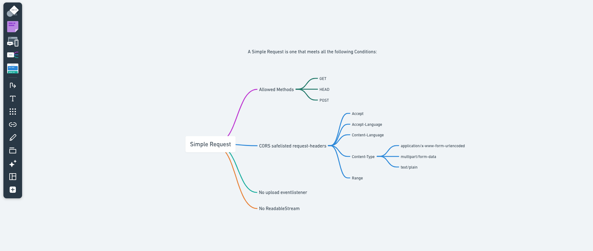
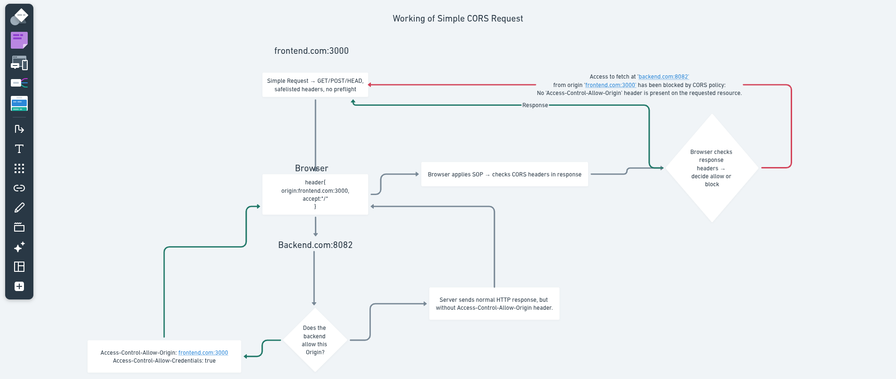

# Cross Origin

1. If origin are differents this is called a Cross-Origin
   - a.com:2000 and b.com:3000 both are different origin so we call it Cross Origin.

# What is Cross Origin Resource Sharing(CORS)

1. Cross-Origin Resource Sharing(CORS) is an HTTP-header based mechanism
   - This means CORS works entirely by sending and reading special HTTP headers between the browser and the server to decide whether a web page from one origin can access resources from another origin.
2. When the browser sees a request is `cross-origin`, it automatically adds an `Origin header` to the HTTP request to tell the server where the request came from.

# Types of CORS requests

CORS requests are generally classified into two main types:

- Simple Requests
- Preflight Requests

# Simple Requests

A simple request is a type of `cross-origin` request that the browser `sends directly` without doing a `preflight check first`.

1. A simple request is one that meets all the following conditions:
   - One of the allowed methods:
     - GET
     - HEAD
     - POST
   - CORS-Safelisted Request Headers:- Headers that can be manually set without triggering a CORS preflight.
     - Accept
     - Accept-Language
     - Content-Language
     - Content-Type
       - application/x-www-form-urlencoded
       - multipart/form-data
       - text/plain
     - Range (Single range header Value)
   - No upload eventlistener
     - if you use XMLHttpRequest, you must not have registered event listeners on xhr.upload
     - `xhr.upload.addEventListener('progress', ...); // ❌ This makes it non-simple`
   - No ReadableStream
     - The request must not use a `ReadableStream` for the body.

# Working of Simple Request

# Preflight Request

A preflight request is a special `HTTP OPTIONS` request that the `browser` `automatically` sends to the server before making an actual `cross-origin` `request` (like POST, PUT, DELETE, or PATCH) when that `request` doesn’t `qualify` as “simple”.

`Note:-` If the request is not a simple request, then the browser will first send a preflight request (OPTIONS) before making the actual request.

# Request can be consider as Simple Request if it follow this condition

1. Method: only GET, POST or HEAD
2. Headers: Only these automatically allowed headers:
   - Accept
   - Accept-Language
   - Content-Language
   - Content-Type (but only if its value is one of)
     - text/plain
     - application/x-www-form-urlencoded
     - multipart/form-data
3. No Custom headers (like Authorization,x-Custom-Header, etc)

`Note:-`
Preflight request send two headers to the request i.e `Access-Control-Request-Method` and `Access-Control-Request-Headers`

# What server response to the preflight request

The server send these response to the prefligt request

1. Access-Control-Allow-Origin: https://foo.example
2. Access-Control-Allow-Methods: POST, GET, OPTIONS
3. Access-Control-Allow-Headers: X-PINGOTHER, Content-Type
4. Access-Control-Max-Age: 86400

# Request With Credentials

# What is a credentialed Request?

- A `credentialed request` is a cross origin request that includes `credentials` such as:
  - Cookies
  - Http Authentication infor(Authorization header)
- Normally, `browsers` do not `saved` `credentials` on cross-origin requests.

# How to enable credentials

- `fetch` and `XMLHttpRequest` set `credentials:include` with the request sent to the server

