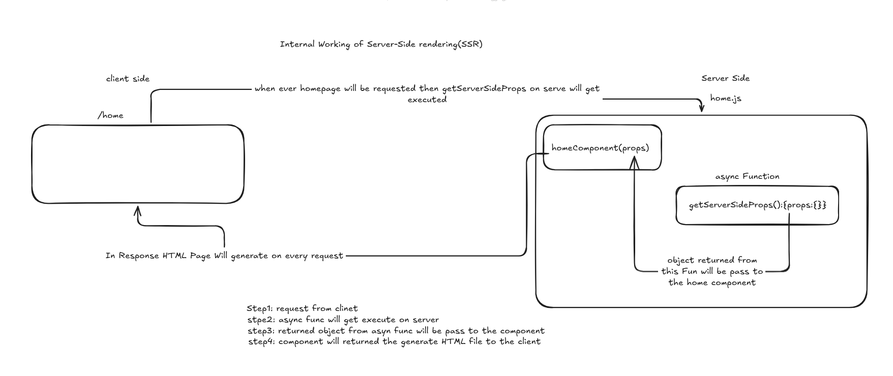
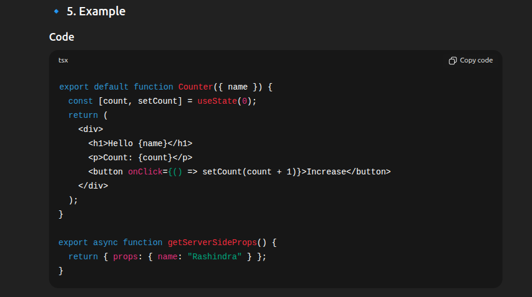
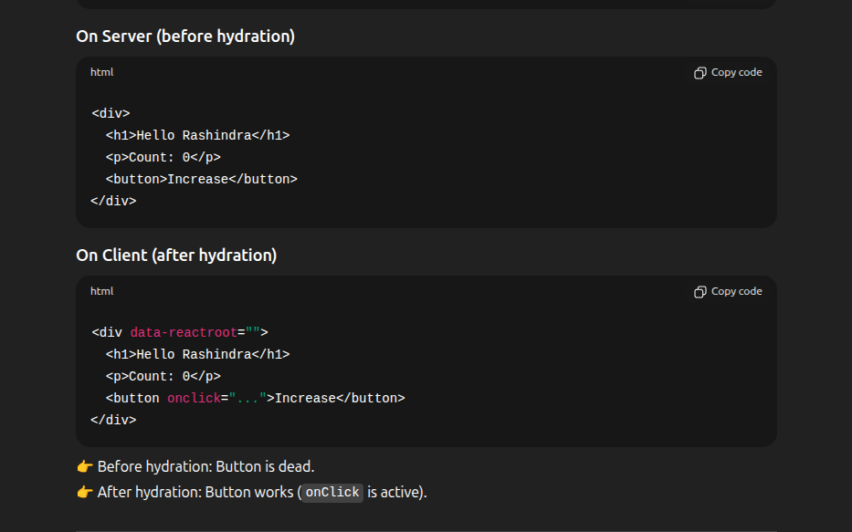

# Server-Side rendering (SSR)

1. If a page uses Server-side Rendering, the page HTML is generated on each request.
2. It executes on the server for each request to this page.
3. Inside this function, we can perform asynchronous operations such as fetching data from an external API.
4. The fetched data is returned as an object with a props key. This object will be passed to the Home component as props.

# Internal working of Server-Side Rendering



- Step 1: Client makes a request
  - User visits /dashboard.
  - Browser sends request to the Next.js server.
- Step 2: getServerSideProps runs on the server
  - Next.js sees the page has getServerSideProps.
  - Executes it on the server.
  - Fetches required data (API, DB, cookies, etc.).
- Step 3: Return props

  - getServerSideProps returns an object like:
  - `{ props: { items: [...] } }`
  - Next.js gives these props to the page component.

- Step 4: Page is rendered into HTML (on the server)
  - Next.js runs the React component with those props.
  - Generates a complete HTML string:
  - `<ul><li>Item 1</li><li>Item 2</li></ul>`
- Step 5: HTML + JSON sent to the client

  - The browser receives:
    - Full HTML (so the page looks complete immediately)
    - JSON data for React hydration

- Step 6: Browser shows HTML instantly

  - The user sees the page content right away.
  - But buttons, inputs, etc. are not interactive yet.

- Step 7: Hydration (on the client)
  - Browser downloads the JS bundle.
  - React runs and hydrates the HTML.
  - Event listeners (like onClick) are attached.
  - Page becomes fully interactive.

# SSR and Hydration in Next JS

1.  What is SSR (Server-Side Rendering)?

    - SSR = Rendering the React page on the server for each request.
    - Next.js runs your getServerSideProps on the server, fetches data, and generates a full HTML page.
    - That HTML is sent to the browser immediately.
    - Page loads with content already visible (better SEO + faster first paint).
    - No "Loading..." flash like in Client-Side Rendering (CSR).

2.  What the Server Sends
    When SSR is used, the server sends two things:

        1.  HTML (pre-rendered page)
            Example
            ```
            <div>
            <h1>Hello Rashindra</h1>
            <button>Increase</button>
            </div>
            ```
            - This makes the page visible right away.
        2.  JSON (page props)

            - Example

            ```
            {
            "pageProps": { "name": "Rashindra" }
            }
            ```

            - This contains the same props that were used to generate the HTML.
            - Purpose: React uses this JSON during hydration.

        3.  Why Hydration is Needed

            - The HTML from the server is static → buttons won’t work, inputs won’t respond.
            - Hydration is the process where React on the client takes control of that static HTML.
              Hydration does two main things:
              1. Verify / Match:
                 - React builds the Virtual DOM with the same props.
                 - Confirms that the Virtual DOM matches the server-rendered HTML.
                 - If not → hydration error.
              2. Activate / Attach Events:
                 - React attaches all event listeners (onClick, onChange, etc.) to the DOM nodes.
                 - React sets up internal state so future re-renders are possible.
                 - Page becomes interactive.

        4.  **_Step-by-Step Flow of SSR + Hydration_**

            - Client requests a page → e.g., /dashboard.
            - Server runs getServerSideProps → fetches data.
            - Server renders React component → outputs HTML using props.
            - Server sends HTML + JSON props to client.
            - Browser displays HTML immediately (but it’s static).
            - React JS bundle loads in browser.
            - React rebuilds Virtual DOM with same props (from JSON).
            - Hydration:
              - Confirms server HTML = Virtual DOM.
              - Attaches event listeners.
              - Sets up state for updates.
            - Page becomes live & interactive.




# Static Site Generation (SSG)

1. If a page uses **_Static Generation_**, the page HTML is generated at build time
2. when we run **_next build_** then HTML page will be generated

# Static Generation without data

- By default, Next.js pre-renders pages using **_Static Generation_** without fetching data.It means this page is generated build time i.e HTML page because it does not have any external service to call like API.
  Example

```
function About() {
  return <div>About</div>
  }
export default About
```

- **_Note:_** This page does not need to fetch any external data to be prerendered. In cases like this, Next.js generates a single HTML file per page during build time.

# Static Generation with data

- Some pages require fetching external data for pre-rendering.
- There are two scenarios, and one or both might apply.

1. Your **_page content depends_** on **_external data_**: Use `getStaticProps`
2. Your **_page paths_** depend on **_external data_**: Use **_getStaticPaths_** (usually in addition to **_getStaticProps_**)

# Scenario 1: Your page content depends on external data

- To fetch this data on pre-render, Next.js allows us to **_export_** an **_async function_** called **_getStaticProps_** from the **_same file_**.
- This **_function_** gets **_called_** at **_build time_**
- The **_fetched data pass_** to the **_page's props_** on **_pre-render_**

Example:-

```
export default function Blog({ posts }) {
// Render posts...
}

// This function gets called at build time
export async function getStaticProps() {
// Call an external API endpoint to get posts
const res = await fetch('https://.../posts')
const posts = await res.json()

// By returning { props: { posts } }, the Blog component
// will receive `posts` as a prop at build time
return {
props: {
posts,
},
}
}
```

# Scenario 2: Your page paths depend on external data

- Next.js allows us to create pages with **_dynamic routes_**.
- For Example, pages/post/[id].js it is dynamic routes and can be access like /post/1

If there are multiple dynamic pages which might depend on external data. To handle this, Next.js lets us `export` an `async function` called `getStaticPaths` from a dynamic page(pages/post/[id].js)

- This function gets called at build time and lets us specify which paths want to pre-render.

```
// This function gets called at build time
export async function getStaticPaths() {
// Call an external API endpoint to get posts
const res = await fetch('https://.../posts')
const posts = await res.json()

// Get the paths we want to pre-render based on posts
const paths = posts.map((post) => ({
params: { id: post.id },
}))

// We'll pre-render only these paths at build time.
// { fallback: false } means other routes should 404.
return { paths, fallback: false }
}
```

```
export default function Post({ post }) {
// Render post...
}

export async function getStaticPaths() {
// ...
}

// This also gets called at build time
export async function getStaticProps({ params }) {
// params contains the post `id`.
// If the route is like /posts/1, then params.id is 1
const res = await fetch(`https://.../posts/${params.id}`)
const post = await res.json()

// Pass post data to the page via props
return { props: { post } }
}
```

# Automatic Static Optimization

- Next.Js Automatically consider a page as static, if the page doesn't contains the methods like `getServerSideProps` and `getInitialProps` then that `page` will be `create` as `HTML page` at build time

