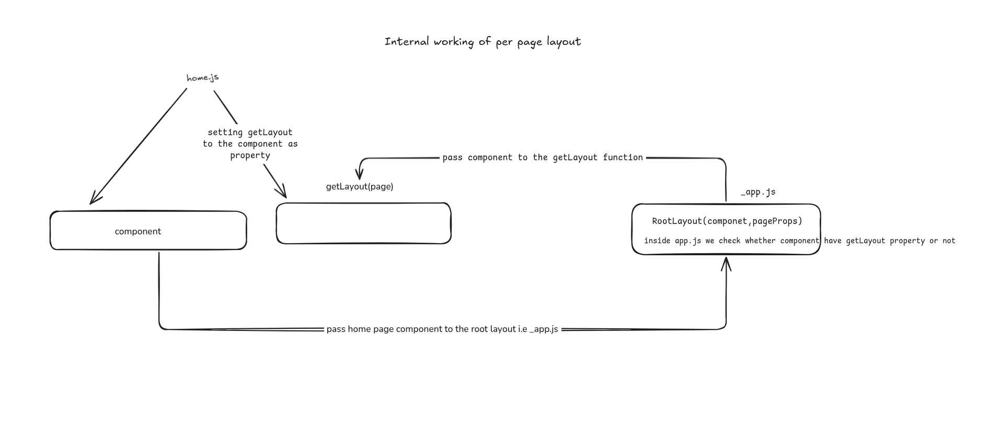
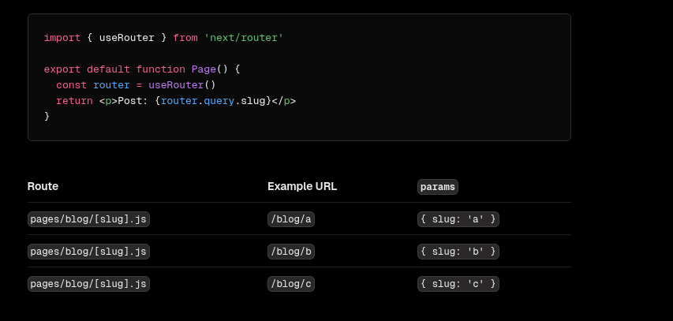

# Routing

- The page router has a **_file system_** based router built on concept of page.
- when a **_file_** is **_added_** to the **_pages directory_** it's **_automatically_** available as a **_route_**.

# Pages and Layouts

- any page inside page folder behave as a route and can be server using file name.

# Example

```
export default function About() {
  return <div>About</div>
}
```

**_Note:-_** This is about page, which can be serve on route **_/about_**

# Index routes

- The route will automatically route files named index to the root of the direcory.
- pages/index.js -----/
- pages/blog/index.js -----/blog

# Nested routes

The router supports nested files. If we create a nested folder structure, files will automatically be routed in the same way.

# Example

```
pages/blog/first-post.js → /blog/first-post
pages/dashboard/settings/username.js → /dashboard/settings/username
```

# Pages with Dynamic Routes

- Next.js supports pages with dynamic routes.
- if you create a file called **_pages/posts/[id].js_**, then it will be accessible at **_posts/1_** and **_posts/2_**

# Layout Pattern

**_Syntax_**

```
import Navbar from './navbar'
import Footer from './footer'

export default function Layout({ children }) {
  return (
    <>
      <Navbar />
      <main>{children}</main>
      <Footer />
    </>
  )
}
```

# Type of Layout Pattern Single Shared Layout and Per-Page Layouts

- Single Shared Layout with Custom App
- Per-Page Layouts

# Single Shared Layout with Custom App

- If you have one layout for Your entire application, You can create a **_Custom App_** and wrap your application with the layout.
- Since the <Layout/> component is re-used changing pages, its component state will be preserved(e.g. input values)

**_Syntax_**

```
import Layout from '../components/layout'

export default function MyApp({ Component, pageProps }) {
  return (
    <Layout>
      <Component {...pageProps} />
    </Layout>
  )
}
```

# Per-Page Layouts

# How Per-Page Layouts Actually Work

1. Create the page component

- Just a normal Next.js page, e.g. DashboardPage.

2. Define a getLayout function

- This function takes the page (ReactNode) as an argument and returns it wrapped in a layout component.
  **_Example_**
  ````const getLayout = (page: React.ReactNode) => (
  <DashboardLayout>{page}</DashboardLayout>
  );```
  ````

3. Assign it as a property of the page component

```
DashboardPage.getLayout = getLayout;
```

4. Use it inside \_app.tsx

- In \_app.tsx, Next.js renders your app. There you check if the current page defines getLayout, and if so, call it. Otherwise, render the page as-is.
  **_Example_**

  ```
  const getLayout = Component.getLayout ?? ((page) => page);
  return getLayout(<Component {...pageProps} />);
  ```

  

# Dynamic Routes | Slug

A Dynamic segement can be created by wrapping a file or folder name in square brackets:[segmentName]. For Example, [id] or [slug]

**_Note:_** Dynamic Segements can be accessed from `useRouter`



# Linking and Navigating

- The Next.js router allows you to do client-side route transitions between pages, similar to a single-page appliaction.
- A React component called `Link` is provided to do this client-side route transition.

# Linking to dynamic paths

There are two way to link dynamic paths

1. using encodeURIComponent
2. using a URL Object

# Imperative Routing

# Shallow Routing

1. Normally in **_Next.js_**, when you **_navigate_** to a **_new URL_** using **_<Link />_** or **_router.push()_**, the **_page runs data fetching methods again (getServerSideProps, getStaticProps, or getInitialProps)_**.

2. With **_shallow routing_**, you can **_change_** the **_URL_** (update query parameters or path) **_without_** **_re-running the data fetching methods_**.

# How to enable shallow routing, set the shallow option to true

```
import { useEffect } from 'react'
import { useRouter } from 'next/router'

// Current URL is '/'
function Page() {
  const router = useRouter()

  useEffect(() => {
    // Always do navigations after the first render
    router.push('/?counter=10', undefined, { shallow: true })
  }, [])

  useEffect(() => {
    // The counter changed!
  }, [router.query.counter])
}

export default Page
```

**_Note:-_** The URL will get updated to **_/?counter=0_** and the page won't get replaced, only the state of the route is changes.
