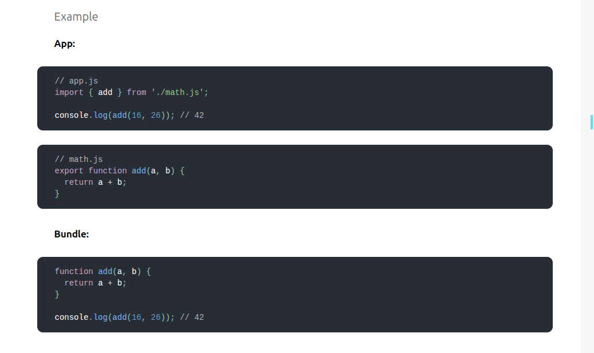

# Bundling
Bundling is the process of following imported files and merging them into a single file: a "bundle".




# Code Splitting
Code splitting is a technique (mainly in frontend development) that `breaks` your `application's``bundle` into `smaller` `chunks` so the `browser` doesn’t have to download all the JavaScript at once.

# Why do we need code splitting?
In large React/Vue/Angular apps, the Javascript bundle becomes huge. Loading everthing on the initial page makes:
- Slow page load
- Poor user experience
- Unnecessary downloads (because some pages/componentes are never visited)

`Note:-Code splitting solves this by loading code only when needed.`

# What exactly is code splitting?
It splits your Javascript into multiple smaller files:
- `Initial bundle` - loads immediately
- `Lazy-loaded chunks` - load when the user visits specific routes or triggers specific actions.


# How code splitting works (in React)

1. Dynamic Import
```
import("./MyComponent").then(module => {
  const MyComponent = module.default;
});

```

2. React Lazy

```
import React, { Suspense } from "react";

const About = React.lazy(() => import("./About"));

function App() {
  return (
    <Suspense fallback={<div>Loading...</div>}>
      <About />
    </Suspense>
  );
}

```

`Note:- Now About.js will only load when <About /> component is rendered.`

# Code splitting in routing (React Router)
```
const Home = React.lazy(() => import("./pages/Home"));
const Profile = React.lazy(() => import("./pages/Profile"));

<Routes>
  <Route
    path="/"
    element={<Suspense fallback={<p>Loading...</p>}><Home /></Suspense>}
  />
  <Route
    path="/profile"
    element={<Suspense fallback={<p>Loading...</p>}><Profile /></Suspense>}
  />
</Routes>;

```

`Note: React.lazy currently only supports default exports.`

# Tools that automatically do code splitting
- Webpack (supports dynamic imports)
- Vite (splits automatically for lazy imports)
- Next.js (built-in page-level code splitting)
- Parcel

# Why code splitting improves performance?
- Faser `First Load`
- Better `LCP (Large Contentful Paint)`
- Loads only what you need - `Saved bandwidth`
- Reduces main-thread blocking