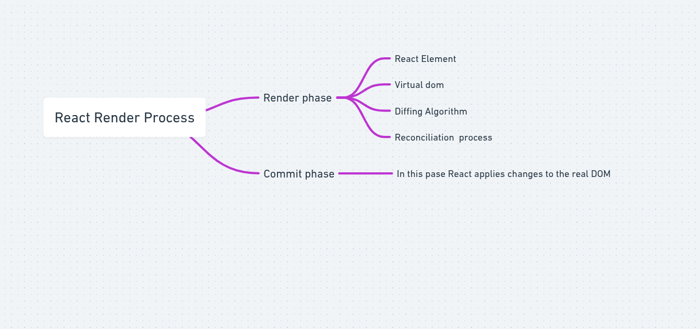

# React JS Topics

1. React Component Lifecycle Methods
2. Virtual DOM and Real DOM
3. what is diffing algorithm
4. what is reconciliation?
5. What is Batching in react?

# React Render process?

React render the component into two phase i.e

1. Render phase
   - React Element
   - Vitual DOM
   - Diffing Algorithm
   - Reconcillation Process
2. Commit phase
   The “Commit phase” is the process of applying those changes to the DOM

