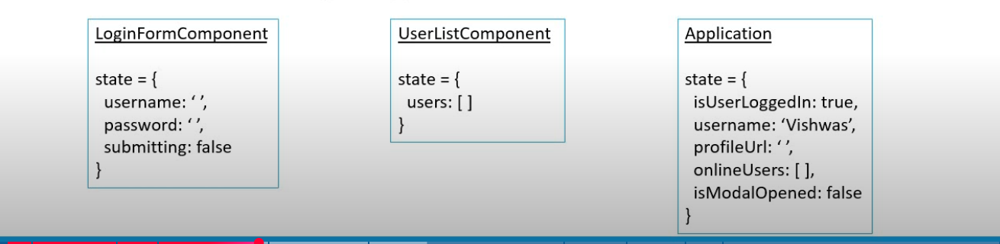
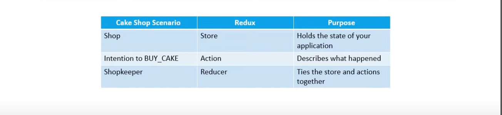
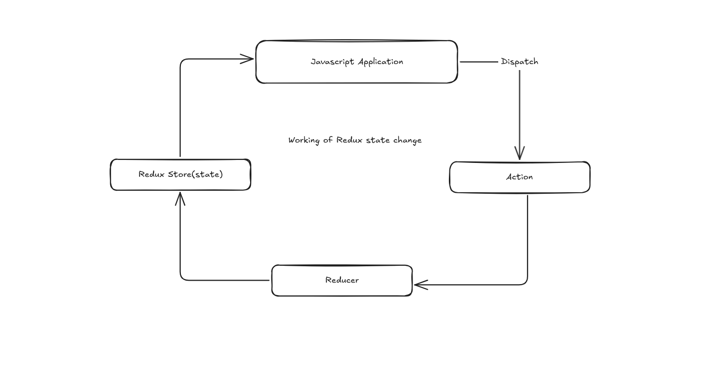
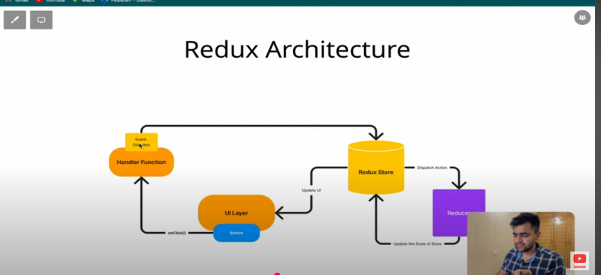

# Redux

Redux is a predictable state container for Javascript apps

- It is for Javascript apps
- It is a state container
- It is predictable
  **_Note:-_**Redux can be used with any Javascript library and framework

# Redux is a state container

- Redux stores the state of your application
- Consider a React app - state of a component
- State of an app is the state represented by all the individual components of that app
- Redux will store and manage the application state



# Three core Concepts of Redux



- Store:- A **_store_** that holds the state of your application.
- Action:- A **_action_** that describes the changes in the state of the application.
- Reducer:- A **_reducer_** which actually carries out the state transition depending on the action.

# Working of Redux internally



# Actions

- The only way your application can interact with the store that is action
- Carry some information from your app to the reudx store
- Action is a plain Javascript objects which have a **_type_** property that indicates the types of action being performed.
- The **_type_** property is typically defined as string constants.
  **_Example_**

```
{
   type:"INCREMENT",
   infor:"First redux action"
}
```

# Reducers

- Reducer specify how the app's state changes in response to actions sent to the store
- Function that accepts state and action as arguments, and returns the next state of the application

**_Example_**

```
function(state,action){
   return newState;
}
```

# Redux Store

one store for the entire application
**_Responsibilities:-_**

- Holds application state
- Allows access to state via **_getState()_**
- Allows state to be updated via **_dispatch(action)_**
- Registers listeners via **_subscribe(listener)_**
- Handles unregistering of listers via the function returned by subscribe(listener)

# CombineReducers

In Redux, the **_combineReducers_** function is used to combine multiple reducer functions into a single root reducer.

# Middleware

- Middleware is the suggested way to extend Redux with custom functionality.
- Provides a `third-party` extension point between `dispatching` an `action`, and the moment it `reaches` the `reducer`.
- Use `middleware` for logging, crash reporting, performing asynchronous tasks etc.

# How to applymiddleware

- In Redux, there is a function called `applyMiddleware` that is used to apply `one` or `more` `middleware` to the store.
- It takes the middleware(s) as arguments and is passed as the second argument to createStore().

`Example`

```
import { createStore, applyMiddleware } from "redux";
import thunk from "redux-thunk";
import rootReducer from "./reducers";

const store = createStore(
rootReducer, // first argument → reducer
applyMiddleware(thunk) // second argument → middleware enhancer
);
```

`Note:-` You can pass multiple middleware separated by commas.
`applyMiddleware(thunk, logger, customMiddleware)`

- `applyMiddleware()` returns a `store enhancer`, which modifies the store’s dispatch behavior.

# Actions

There are `two types` of actions

- Synchronous Actions
- Async Actions

# Synchronous Actions

As soon as an action was dispatched, the state was immediately updated.
If you disptach the `BUY_CAKE` action, the `numOfCakes` was right away decremented by 1.
Same with `BUY_ICECREAM` action as well.

# Async Actions

Asynchronous API calls to fetch data from an end point and use that data in your appliction.

# Redux Thunk

- Redux Thunk is a middleware for Redux that allows you to write async logic (like API calls) inside your action creators.
- Without Thunk, Redux actions must be plain objects.

- With Thunk, you can dispatch functions (thunks) that contain async code.

# Why We Need Redux Thunk

- Redux’s dispatch() normally handles only plain objects:
  ```
  store.dispatch({ type: "FETCH_DATA" });
  ```
- But for async operations (like fetching data), we need to:

  - Wait for a network call to finish.
  - Dispatch success or failure actions after we get the result.

- Thunk lets us delay dispatching actions until an async task is complete.

# How it works(Internally)

- You dispatch a function instead of an object:

```
store.dispatch(fetchUsers());
```

- The Thunk middleware intercepts it before it reaches reducers.
- If the dispatched action is a function, Redux Thunk:
  - Calls that function.
  - Passes in `dispatch` and `getState` as arguments.
- You can then:

  - Dispatch normal actions inside it.
  - Perform async work (API calls, timers, etc.).
  - Handle success/error manually.

**_Example_**

```
const fetchUsers = () => {
return async (dispatch) => {
dispatch({ type: "FETCH_USERS_REQUEST" });

    try {
      const res = await fetch("https://jsonplaceholder.typicode.com/users");
      const data = await res.json();
      dispatch({ type: "FETCH_USERS_SUCCESS", payload: data });
    } catch (error) {
      dispatch({ type: "FETCH_USERS_FAILURE", payload: error.message });
    }

};
};
```

# Applying Middleware

```
import { createStore, applyMiddleware } from "redux";
import thunk from "redux-thunk";

const store = createStore(rootReducer, applyMiddleware(thunk));
```

# Key points to Remember

✅ Thunk = Function that returns a function
✅ Middleware = Intercepts dispatch before reducer
✅ dispatch() can now handle both objects and functions
✅ Use Thunks for:

- API calls
- Conditional dispatching
- Delayed or batched actions

# Create Store

1. import the `createStore` function from the redux, where `redux` is `dependency` package
2. Now, create one `reducer` which is simple function having `two parameters` i.e `state and action`

# Dispatch event

1. first import the `useDispatch` from the `react-redux`
2. use this hooks in handler function and pass one object which have `type` key which help reducer to decide which function will execute.

# Provider

1. import Provider from the `react-redux`
2. import `store` that you have created into the store using `createStore` function
3. Wrap the `componets` using `Provider` componet of `react-redux` and `pass store as props to the Component`

# Selector

1. import `useSelector` hook from react-redux
   This hook is use to select the data from the store.



```

```
